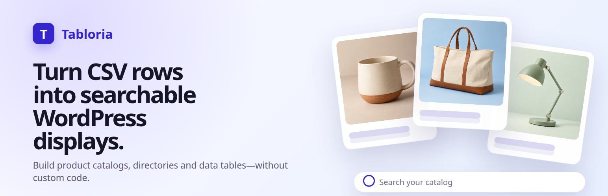

# Tabloria - CSV Product Catalog & Searchable Displays

[](https://github.com/Aroxed/Tabloria/actions/workflows/ci.yml)
[](https://wordpress.org/plugins/tabloria-searchable-displays/)
[](LICENSE)



Tabloria turns a product CSV into a searchable WordPress catalog with cards, filters, and a Gutenberg block. It also supports directories, listings, schedules, pricing tables, coupon displays, and responsive data tables.

[Website](https://tabloria.site/) · [Live demo](https://tabloria.site/demo.html) · [WordPress.org](https://wordpress.org/plugins/tabloria-searchable-displays/)

The current WordPress.org release is **0.2.2**.

## Features

- Guided CSV upload, column detection, field mapping, and preview.
- Seven display types: Searchable Listings, Product Catalog, Team Directory, Event Schedule, Pricing Table, Coupon Code Display, and Simple Data Table.
- Instant search, visitor filters, default filters, sorting, pagination, and custom empty-result text.
- Reusable Master Displays with a different exact-value filter on each page.
- Coupon reveal, click-to-copy, affiliate links, and deal-only rows in the same CSV.
- Native Gutenberg Display and Display Grid blocks.
- Shortcode support for classic editors, widgets, and page builders.
- Responsive cards and horizontally scrollable data tables.

## Install

For a normal WordPress installation, install **Tabloria - CSV Product Catalog & Searchable Displays** from the WordPress plugin directory or download the [latest official ZIP](https://downloads.wordpress.org/plugin/tabloria-searchable-displays.latest-stable.zip).

For local development, copy or mount `tabloria-searchable-displays/` into `wp-content/plugins/`, then activate it in WordPress.

## Basic workflow

1. Open **Tabloria → Create Display**.
2. Upload a CSV file.
3. Choose a display type and map the detected columns.
4. Configure search, filters, sorting, pagination, and appearance.
5. Save the Display and insert it with the **Tabloria Display** block.

## Reuse one Display across category pages

Keep all categories in one CSV and create one saved Display. Insert that same Display on each page, then use **Filter this placement by** in the Gutenberg block sidebar to select a column and enter the value for that page.

The shortcode equivalent is:

```text
[tabloria id="123" filter_field="category" filter_value="Travel"]
```

Matching is exact and case-insensitive. Search, visitor filters, sorting, and pagination operate on the remaining rows.

## Coupon Code Display

Map the optional **Coupon code** and **Affiliate link** columns:

- Rows with a coupon code show a reveal action, open the affiliate URL in a new tab, and let visitors copy the code.
- Rows without a code show a customizable direct action such as **View deal** or **Visit website**.

See the [detailed guide](tabloria-searchable-displays/docs/REUSABLE-DISPLAYS-AND-COUPONS.md) and [sample coupon CSV](tabloria-searchable-displays/samples/coupons.csv).

## Development

Start the local WordPress environment:

```bash
docker compose up -d
```

Run frontend tests:

```bash
cd tabloria-searchable-displays
npm run test:frontend
```

Run PHP syntax checks and integration tests inside the WordPress container:

```bash
docker compose exec -T wordpress sh -lc \
  "cd /var/www/html/wp-content/plugins/tabloria-searchable-displays && \
  find . -name '*.php' -print0 | xargs -0 -n1 php -l && \
  php tests/run-unit-tests.php && \
  php tests/wordpress-smoke.php"
```

## Repository structure

- `tabloria-searchable-displays/` — plugin source, runtime assets, tests, samples, and documentation.
- `wordpress-org-assets/` — reproducible WordPress.org banners and screenshots.
- `docker-compose.yml` — local WordPress development environment.

## Contributing and security

See [CONTRIBUTING.md](CONTRIBUTING.md) before opening a pull request. Please report security issues through the process in [SECURITY.md](SECURITY.md), not through a public issue.

## License

GPL-2.0-or-later. See [LICENSE](LICENSE), the plugin header, and `readme.txt` for release metadata.
